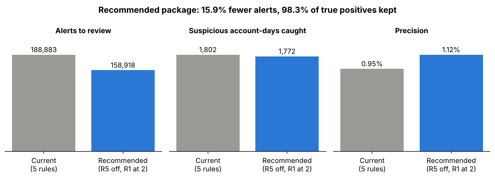
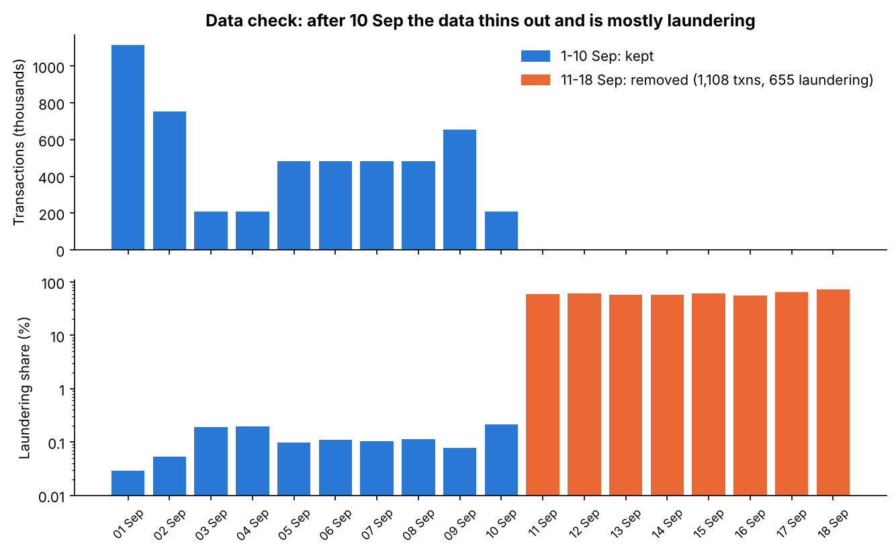
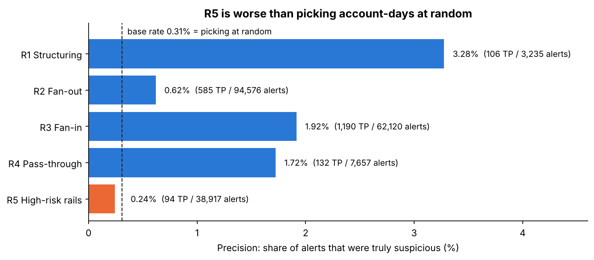
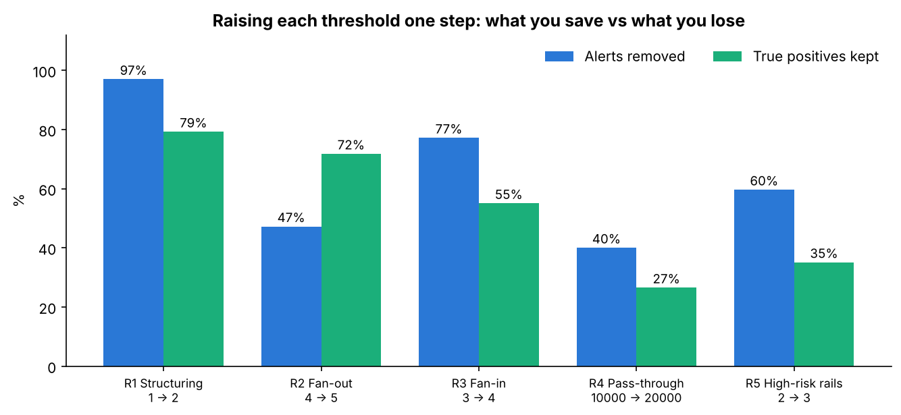
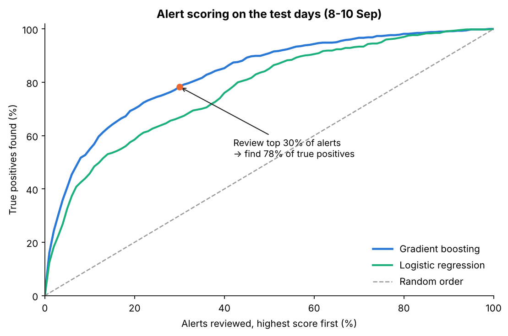
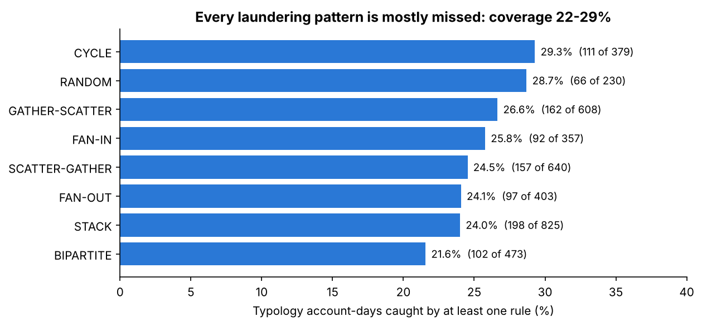

# Signal Over Noise: AML Alert Tuning

**Which transaction-monitoring rules earn their alerts, and how far can a risk score shrink the review queue?**

I ran five common monitoring rules over **4.49 million synthetic bank transfers**, measured how many of their alerts were truly suspicious, tested stricter thresholds, and trained a model to put the riskiest alerts at the top of the queue.

**[Open the interactive explorer](https://salil360-cyber.github.io/signal-over-noise-aml-alert-tuning/)**: switch rules on and off, drag thresholds, and see the effect on alerts and catches.

> All data is synthetic (IBM AMLworld). No real customers or banks are involved.

---

## Key results

| | Current (5 rules) | Recommended package |
|---|---|---|
| Alerts to review | 188,883 | **158,918 (15.9% fewer)** |
| Suspicious account-days caught | 1,802 | **1,772 (98.3% kept)** |
| Precision | 0.95% | **1.12%** |

- **R5 (repeated wire/bitcoin use) is worse than random.** Its precision is 0.24%, below the 0.31% you get by picking account-days at random. Recommendation: retire it.
- **R1 (structuring) at 2+ payments instead of 1+** cuts its alerts by 97% (3,235 → 97) and still keeps 84 of its 106 true positives.
- **A risk score reorders the queue.** On unseen test days, reviewing the top 30% of alerts by gradient-boosting score finds **78%** of the true positives (random order finds 30%).
- **The bigger problem is coverage.** The five rules alert on only **25.3%** of suspicious account-days, and every laundering pattern in the dataset is caught at 22–29%. Tuning reduces noise; it does not fix what the rules cannot see.



---

## Data

- **Source:** IBM *Transactions for Anti-Money Laundering* (AMLworld), file `HI-Small_Trans.csv` (5,078,345 transfers, 5,177 marked as laundering) and `HI-Small_Patterns.txt`.
  Altman et al., *Realistic Synthetic Financial Transactions for Anti-Money Laundering Models*, NeurIPS 2023 Datasets & Benchmarks.
- **Download:** [Kaggle: ealtman2019/ibm-transactions-for-anti-money-laundering-aml](https://www.kaggle.com/datasets/ealtman2019/ibm-transactions-for-anti-money-laundering-aml). Put both files next to the script. The raw data (~475 MB) is not in this repo.

### Data-quality finding

After 10 Sep the file thins out to 1,108 transfers, and 655 of them (59%) are laundering. Keeping that tail would inflate every precision figure, so the analysis uses **1–10 Sep only** and also drops self-transfers. That leaves 4,486,418 transfers and 4,514 laundering transfers.



Amounts are converted to USD with rates **derived from the data itself** (the median received/paid ratio for every currency paid in that currency and received in USD), so no outside FX table is needed. All 15 currencies get a rate.

---

## Method

**Unit of analysis: one account on one day ("account-day").** Rules alert on an account's behaviour on a day, which is how analysts review alerts. There are 2,315,960 account-days, of which 7,130 (0.31%) involve a laundering transfer. That 0.31% is the base rate any rule has to beat.

### The five rules (baseline thresholds)

| Rule | Fires when an account, in one day… | Baseline | Alerts | True positives | Precision |
|---|---|---|---|---|---|
| R1 Structuring | makes cash payments of $9,000–9,999.99 | 1+ | 3,235 | 106 | 3.28% |
| R2 Fan-out | pays many different accounts | 4+ | 94,576 | 585 | 0.62% |
| R3 Fan-in | receives from many different accounts | 3+ | 62,120 | 1,190 | 1.92% |
| R4 Pass-through | receives $10k+ and sends 80–120% of it out | $10k | 7,657 | 132 | 1.72% |
| R5 High-risk rails | makes several wire or bitcoin payments | 2+ | 38,917 | 94 | 0.24% |



### Above-the-line test: raise each threshold one step



R1 is the stand-out: raising it to 2 removes 97% of its alerts while keeping 79% of its catches. The other rules lose too many true positives for the alerts they save, so they stay as they are.

### Alert risk scoring

- Features per alert: counts, amounts (log), counterparties, pass-through ratio, cash near $10k, wire/bitcoin count, and which rules fired.
- **Time split, no peeking:** train on alerts from 1–7 Sep (133,242), test on 8–10 Sep (55,641; 1.09% true positives).
- Models: logistic regression (balanced classes) and scikit-learn's HistGradientBoosting.

| Model | PR-AUC (random = 0.011) | TP in top 10% | TP in top 30% | Review needed to find 80% of TP |
|---|---|---|---|---|
| Logistic regression | 0.105 | 45.8% | 66.8% | 42.9% |
| Gradient boosting | 0.143 | 54.9% | 78.3% | 32.3% |



### Coverage by laundering pattern



---

## Limitations

- **Synthetic data.** Patterns are simulated; real-world precision and volumes will differ.
- **Labels are a proxy.** An account-day is "suspicious" if it touches at least one laundering transfer. In a bank, the truth would come from investigation outcomes (whether a suspicious activity report was filed).
- **Coverage is low (25.3%).** This study tunes existing rules; it does not design new ones to catch the other 75%.
- **The pattern file is a subset** (3,209 transfers), so the typology shares are indicative.
- **Model numbers can shift slightly** with library versions (I have seen the top-30% figure at 77–78% across set-ups). The rule and package numbers are exact counts and do not change.
- Thresholds were tested one step at a time, not optimised jointly.

---

## How to run

```bash
pip install -r requirements.txt
# put HI-Small_Trans.csv and HI-Small_Patterns.txt in this folder
python signal_over_noise_pipeline.py   # prints results, writes outputs/*.csv and outputs/results.txt
python charts.py                       # draws images/*.png from outputs/ (with number checks)
```

**SQL version (PostgreSQL).** The same logic in plain SQL, verified to give identical counts:

```bash
createdb aml
psql -d aml -f sql/01_load.sql          # load, data-quality check, FX from data, 1-10 Sep window
psql -d aml -f sql/02_features.sql      # account-day features
psql -d aml -f sql/03_rules.sql         # rule scorecard, one-step raise, recommended package
psql -d aml -v acct='001047-801C31E90' -v d='2022-09-02' -f sql/04_case_pull.sql   # pull one alert for review
psql -d aml -f sql/05_explorer_data.sql # tables behind the interactive explorer
python build_explorer.py               # rebuilds docs/index.html
```

## Repository structure

```
signal_over_noise_pipeline.py   full pipeline (DuckDB + pandas + scikit-learn)
charts.py                       README charts, cross-checked against the outputs
build_explorer.py               builds the interactive explorer (docs/index.html)
sql/                            PostgreSQL version: load, features, rules, case pull
outputs/                        results.txt and every table behind the charts
images/                         charts used in this README
docs/                           interactive explorer (GitHub Pages)
```

## Skills shown

SQL (CTEs, aggregation with FILTER, FULL OUTER JOIN, percentiles) · Python (DuckDB, pandas, scikit-learn, matplotlib) · AML transaction monitoring: rule precision, above-the-line threshold testing, alert prioritisation, typology coverage · data-quality checks.

---

*Salil Gokhale · [LinkedIn](https://www.linkedin.com/in/salil-gokhale-analytics) · [GitHub](https://github.com/Salil360-cyber)*
